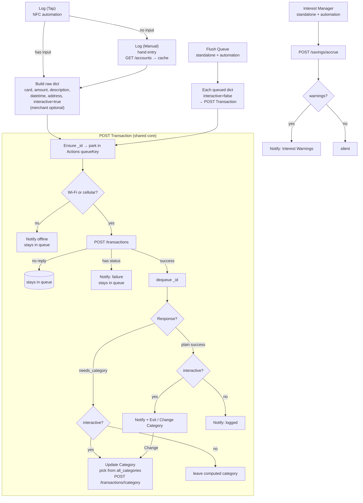

# The Bridge

A minimal, extensible Flask service that turns HTTP POSTs (from an Apple Shortcut,
or any client) into Notion Transaction rows. Built with an app factory + blueprints
so future phone-to-Notion projects can add endpoints without touching existing ones.

## Status

- **Phase 0 (Foundation) — done:** app factory + blueprints, `config.py`,
`require_api_key` auth, `GET /health`. Deployable to PythonAnywhere.
- **Phase 1 (Digestion) — done:** `POST /transactions` validates the raw dict,
signs the amount, maps `card` -> account page id, and resolves `Date` +
`Month` from `datetime`.
- **Phase 2 (Saving) — done:** `POST /transactions` now writes to Notion. It
resolves the name-based relations (`Category`, `Month`, transfer
`To Account`) via `notion_client`, creates the page, and
returns `201 {"page_id", "public_url"}`. A supplied name that has no matching
row is skipped (never blocks the write) and reported under `warnings`.
- **Phase 3 (Memory) — done:** a JSON store remembers which categories each
  merchant has been filed under (learned only from bridge posts, never by
  reading Notion). One known category auto-fills; an ambiguous or unknown
  merchant is created uncategorised and flagged `needs_category` so the shortcut
  can prompt, then confirm via `POST /transactions/<page_id>/category`.
- **Savings interest — done:** `POST /savings/accrue` computes the interest
  Trading 212's API never exposes. A daily scheduled task accrues each
  interest-earning account's interest into Notion and, on the account's payment
  day, files the accumulated total as an income transaction (see
  [Savings interest](#savings-interest)).

## Layout

```
flask_app.py                  # PythonAnywhere WSGI entry: exposes `application`
app/__init__.py               # create_app() factory; logging hooks + blueprints
app/config.py                 # env vars (NOTION_TOKEN, API_SECRET) + Notion data source IDs
app/logging_setup.py          # log format + client_id filter (body `_id` / accrue run id)
app/sentry_setup.py           # optional Sentry init when SENTRY_DSN is set
app/auth.py                   # require_api_key decorator (checks X-API-Key header)
app/notion_client.py          # requests wrapper: query_by_name, list_names, query_all, list_accounts, create_page, update_page
app/blueprints/health/        # GET /health (public), GET /health/auth (key-protected)
app/blueprints/transactions/       # POST /transactions + /<id>/category (validate, resolve, write, learn)
app/blueprints/transactions/merchant_memory.py  # JSON merchant -> category store
app/blueprints/savings/       # POST /savings/accrue (daily interest accrual + monthly payout)
app/data/merchant_categories.json    # learned merchant -> category counts (gitignored)
```

The `card` → account mapping lives entirely in **Notion** (see
[Account links](#account-links)); there is no local mapping file.

## `POST /transactions`

Send the shortcut's `raw dict` with the `X-API-Key` header. `card`, `amount`,
and one of `description`/`merchant` are required; `type` defaults to `expense`.

```bash
curl -X POST http://127.0.0.1:5000/transactions \
  -H "X-API-Key: <API_SECRET>" -H "Content-Type: application/json" \
  -d '{"merchant":"Tesco","card":"Revolut Visa","amount":"£12.50",
       "description":"Weekly shop","datetime":"2026-07-28T14:30:00",
       "category":"Groceries"}'
```

On success returns `201 {"page_id": ..., "public_url": ...}`, where `public_url`
is Notion's page `url`. Errors use the `{status, message}` shape the shortcut
treats as a failure.

Amount is parsed by ripping digits (so `"£12.50"` -> `12.5`) and signed by
`type`: expense = `-abs` (fills `From Account`), income = `+abs` (fills
`To Account`), transfer = `-abs` (fills `From Account`, plus `to_account` as the
destination `To Account`). `datetime` falls back to now when missing or
unparseable.

Both accounts on a transfer are resolved from Notion (see
[Account links](#account-links)): `card` sets `From Account` and `to_account`
sets `To Account`. Each must match an account's codename or `Apple Card` value
(case-insensitively) — `to_account` accepts the same labels `card` does. An
unknown `card` or `to_account` is rejected with an error listing the known
labels rather than silently left blank.

The exact input payload is also written to a `rawPayload` rich-text property on
the created page (JSON, truncated to Notion's 2000-char limit) for debugging and
audit. When the request includes an `_id`, that value is written to an `_id`
rich-text property on the page as well (for correlating the Notion row with the
originating request). Add `rawPayload` and `_id` text columns to the
Transactions data source to capture them.

Name-based relations are resolved by looking up the matching row in Notion:
`category` -> the `Category` property and the derived month -> `Month`.
Resolution is best-effort and never
blocks the write: a name with no matching row — or a lookup that errors (e.g. a
data source not shared with the integration) — is left blank instead of failing,
and each skip is reported in an optional `warnings` array on the success
response:

```json
{"page_id": "...", "public_url": "...",
 "warnings": ["No Category match for 'Grocries'; left blank."]}
```

Requires `NOTION_TOKEN` and the four `*_DS_ID` values to be configured.

## Account links

The `card` → account mapping lives in Notion, on the Accounts data source
(`ACCOUNTS_DS_ID`). Each account row carries:

- its **codename** — the page title, e.g. `Revolut Visa`; and
- an `Apple Card` text (or select) property holding the exact card name
Apple hands over.

To link a card, type the Apple-given name into the `Apple Card` property on the
matching account row. Leave it blank for accounts only ever chosen manually —
the codename still resolves.

Accounts with the `Archived` checkbox ticked are skipped entirely (never
resolved, never listed). The remaining accounts are returned in reverse of
Notion's row order.

The bridge reads the Accounts data source and resolves an incoming `card` (or
transfer `to_account`) against **either** the codename **or** the `Apple Card`
value, **exact + case-insensitive**. Both the manual picker's codenames and a
tap's Apple card name share one keyspace, so the bridge never needs to know
which entry point sent the value. The resolved map is cached in-process for an
hour, so a newly edited link may take a short while to appear.

`ACCOUNTS_DS_ID` is **required** — there is no local fallback. A request errors
if it is unset, if Notion is unreachable with no cached map, or if `card` matches
no codename or `Apple Card` value (the error lists the known labels). If two rows
claim the same label (an `Apple Card` value colliding with another account's
codename), the bridge refuses the map with an error so the clash is fixed in
Notion rather than silently resolving to the wrong account.

### `GET /accounts`

Returns the account codenames so the shortcut can build its card picker from
Notion instead of a hardcoded list.

```bash
curl -H "X-API-Key: <API_SECRET>" http://127.0.0.1:5000/accounts
```

```json
{"accounts": ["NatWest Debit", "Revolut Visa", "ISave", "Pocket"]}
```

The list is drawn from Notion and cached like the resolver above. Errors use the
same `{status, message}` shape.

## Merchant memory & categories

If the request omits `category`, the bridge picks one from what it has learned
about the merchant (stored in `app/data/merchant_categories.json` as
`{"tesco": {"Groceries": 5, "Household": 1}}`, populated **only** by bridge
posts — it never reads the Notion table):

- **One known category** → auto-filled; the write proceeds as normal.
- **Two or more (ambiguous)** or **none (unknown merchant)** → the row is created
uncategorised and the response adds `needs_category`, so the shortcut prompts
and confirms the pick.

Every success response also carries `category` (the category actually applied,
or `null`) and `all_categories` (every category in Notion). This means the
shortcut can **always** offer a "change category" option — even after an
auto-fill — by letting you pick from `all_categories` and calling
`POST /transactions/<page_id>/category`.

```json
{"page_id": "...", "public_url": "...", "category": "Groceries",
 "all_categories": ["Groceries", "Household", "Eating Out", "..."],
 "needs_category": true, "candidates": ["Groceries", "Household"]}
```

`candidates` (present only with `needs_category`) are the merchant's known
categories, most-used first (empty for an unknown merchant). Whenever a category
is actually applied (explicit, auto-filled, or confirmed) it is learned against
the merchant. The category list is cached in-process for a few minutes, so a
newly added Notion category may take a short while to appear.

The shortcut must check response keys in order: `status` (error) →
`needs_category` (prompt) → otherwise success (with an optional "change"
affordance).

If the request body includes an `_id` key, it is echoed back verbatim on the
response (both success and error) so the caller can correlate a response with
the request it sent. On a successful create it is also stored on the Notion
page's `_id` property. An `interactive` key is echoed the same way but only on
success responses. Passthrough echo applies to both transaction endpoints.

## `POST /transactions/<page_id>/category`

Sets the category the user picked after a `needs_category` response, patches the
Notion relation, and records the association so the merchant is remembered next
time.

```bash
curl -X POST http://127.0.0.1:5000/transactions/<page_id>/category \
  -H "X-API-Key: <API_SECRET>" -H "Content-Type: application/json" \
  -d '{"merchant":"Tesco","category":"Groceries"}'
```

Returns `200 {"page_id": ..., "public_url": ..., "category": ...}` on success,
where `public_url` is the same Notion link the create endpoint returns.

Note: `<page_id>` in the URL must be the **Notion** page id returned by
`POST /transactions` (the `page_id` field), not the client-supplied `_id` echoed
back on the response. Sending the `_id` here makes Notion fail to find the page.

## Savings interest

The feature is driven entirely from Notion: tick an **`Earns Interest`** checkbox 
on any account and fill in its rate, and the bridge picks it up — no code or 
config change per account.

Notion is the single source of truth for the accrued state, so there is no local
ledger to keep in sync and the accrual survives a PythonAnywhere disk reset.

### The model (accrual vs. transaction)

- **Accrual** is not a transaction. Each day the bridge adds that day's interest
  to an **`Accrued Interest`** number on the account row — it never touches your
  balance or writes to the Transactions table.
- **Payout** is a transaction. On the account's payment day — or the first run
  after it that month, if a run was missed — the accumulated `Accrued Interest`
  is filed as a single **income** transaction (through the same trusted write
  path as `POST /transactions`) and the accrual resets to 0.

The daily rate is the compound-equivalent `(1 + AER) ^ (1/365) - 1`, applied to
`Current Balance` (which excludes the unpaid accrual, so there is no intra-month
compounding — the daily rate already reflects AER's annual compounding). Because
accrual runs **daily**, a mid-month AER change is captured correctly: each day is
accrued at whatever rate was in effect that day, and a later change never
rewrites what already accrued.

The pass is idempotent per day (guarded by `Last Accrued`) and pays out at most
once a month (guarded by `Last Interest Paid`), so a scheduled task that fires
twice never double-accrues or double-pays. A missed day is caught up on the next
run at the current balance as an approximation. Because the payout fires on the
payment day **or the first run after it**, a missed run on the day itself still
pays that month, and any `Interest Payment Day` is safe — including values like
`31` in short months (it pays on the last run of the month instead).

The payout is filed against the account like any other transaction, so the
account must still resolve as a `card` (its codename or `Apple Card` value — see
[Account links](#account-links)). An account that is due a payout but can't be
resolved keeps accruing and the response reports it under `warnings`.

### `POST /savings/accrue`

Runs the daily pass. Send with the `X-API-Key` header and no body.

```bash
curl -X POST http://127.0.0.1:5000/savings/accrue -H "X-API-Key: <API_SECRET>"
```

Returns `200` with a per-account snapshot plus any `warnings`:

```json
{"accounts": [{"page_id": "...", "name": "212 Saving", "public_url": "...",
   "balance": 5000.0, "daily_rate": 0.0000969, "todays_interest": 0.4846,
   "accrued": 14.53, "paid": false}],
 "warnings": []}
```

`paid` is `true` on the run that files the monthly transaction (with `accrued`
reset to 0). Errors use the same `{status, message}` shape as the other
endpoints.

### Enabling an account

1. Tick `Earns Interest` on the account row.
2. Set `AER %` (as a percent) and `Interest Payment Day`.
3. Ensure the account resolves as a card (codename or `Apple Card`) so the payout
   can be filed. `212 Saving` already resolves via its codename.

The first payout after enabling covers only the days accrued so far that month
(a partial month), which is expected.

## The Apple Shortcut

The client is a set of small, single-purpose shortcuts rather than one monolith,
so each pathway stays readable and the network/category/offline logic lives in
one place. The two entry points (`Log (Tap)`, `Log (Manual)`) build a raw dict
and hand it to `POST Transaction`, which does the actual send and delegates the
category pick to `Update Category`. Alongside the logging suite, a standalone
`Interest Manager` drives the savings accrual endpoint on a schedule.

The suite needs the **Actions** app on the phone. It owns both:

- **Global text variables** — the offline queue (`queueKey`) and the accounts
  cache (`accountsCacheKey`).
- **Rich notifications** — threaded by `_id`, Notion URL on tap, notification
  action buttons. Titles look like
  `Transaction <_id> (PLEASE READ THE ACTION DESCRIPTION)`; the real body lives
  in the action description (subtitle / category / failure detail).

Shared shortcut variables: `baseURL` (the bridge host) and `apiKey` (sent as
`X-API-Key`).


| Shortcut           | Role                                                                                                                                                                                                                                            | Get it                   |
| ------------------ | ----------------------------------------------------------------------------------------------------------------------------------------------------------------------------------------------------------------------------------------------- | ------------------------ |
| `Log (Tap)`        | NFC-automation entry point fired by a card tap. Builds the raw dict from its `Shortcut Input` (`merchant`, `card`, `amount`), asks for the `description`, then runs `POST Transaction`. Falls back to `Log (Manual)` when it receives no input. | *paste iCloud link here* |
| `Log (Manual)`     | Hand-logging entry point. Refreshes the accounts cache from `GET /accounts` when online, picks a card from the cache, then prompts for `description`, `amount`, `type` (and `to_account` for transfers), and optional `notes`, then runs `POST Transaction`. | *paste iCloud link here* |
| `POST Transaction` | Shared core: ensures an `_id`, parks the dict in the Actions queue, POSTs to `/transactions` when online, and branches on the response — fail, `needs_category`, or success — then dequeues on a successful reply.                              | *paste iCloud link here* |
| `Update Category`  | Reusable picker: lists `all_categories`, POSTs the choice to `/transactions/<page_id>/category`, and reports success or failure. Called on a `needs_category` reply and from the success "Change Category" menu.                                  | *paste iCloud link here* |
| `Flush Queue`      | Standalone + automation: replays each queued transaction through `POST Transaction` with `interactive` off; successful replays dequeue themselves inside `POST Transaction`.                                                                   | *paste iCloud link here* |
| `Interest Manager` | Standalone + automation: POSTs to `/savings/accrue` to run the daily savings-interest accrual (and monthly payout), then surfaces any `warnings` the bridge returns. Meant to run unattended on a daily schedule.                                | *paste iCloud link here* |


Both entry points seed the same base fields — `address` (from Current Location),
`datetime` (Current Date), and `interactive: true` — so `POST Transaction`
behaves identically whichever pathway called it. `description` is the row's
title. `merchant` is optional: it never becomes the title, it only feeds the
bridge's merchant-memory so a category can be learned and auto-filled.
`Log (Tap)` passes through whatever `merchant` / `card` / `amount` the tap
supplied; `Log (Manual)` picks `card` from the accounts cache and omits
`merchant`, so its title comes purely from `description`.

### Entry points

`Log (Tap)` first checks its `Shortcut Input`: with nothing to log it runs
`Log (Manual)` and stops, otherwise it seeds `merchant` / `card` / `amount` from
the input, adds location and date, asks for the `description`, and rips the
digits out of `amount` (`Match [0-9.]+` → first match → number) so currency
symbols from Apple Wallet still post clean. It then runs `POST Transaction`.

`Log (Manual)` has no tag to read. When Wi-Fi or cellular is available it
refreshes `accountsCacheKey` from `GET /accounts` (no hardcoded mapping); the
card picker always reads that cache (so a recent list still works offline). It
then walks through `description`, `amount` (asked as a Number — no digit
ripping), `type` (Expense / Transfer / Income), a transfer's `to_account`
(reusing the same accounts list), and an optional **Any Notes?** prompt before
handing the dict to `POST Transaction`.

### `POST Transaction` (shared core)

1. **Idempotency** — if the dict has no `_id`, generate a UUID and set it.
   Replays from `Flush Queue` keep their existing `_id`.
2. **Enqueue** — park the dict in Actions under `queueKey` (a dictionary keyed
   by `_id`) *before* any network call.
3. **Connectivity** — if there is no Wi-Fi SSID and cellular data is off, show a
   failure notification and stop. The entry stays queued.
4. **POST** — send the dict as the body to `POST /transactions` with
   `X-API-Key` + `Content-Type: application/json`.
5. **Branch on the reply** (keys checked in order):
   - **`status` present** → failure notification (entry stays queued for a later
     flush, unless you clear it by hand).
   - **no `status`** → success path: build a notification (Notion `public_url`
     on tap, threaded by `_id`), **dequeue** the `_id` from `queueKey`, then:
     - **`needs_category` + interactive** → run `Update Category` and stop.
     - **`needs_category` + non-interactive** → leave the computed category;
       stop.
     - **plain success + interactive** → notify, then **Exit / Change Category**.
     - **plain success + non-interactive** → notify and stop.

### Category prompt

`POST Transaction` never shows the category picker itself; it delegates to
`Update Category`, which lists the full `all_categories` from the response, POSTs
`{"category": ...}` to `POST /transactions/<page_id>/category`, and notifies
success (`Success Category: …`, Notion URL on tap) or failure
(`Failed Category: …`). It runs in two situations:

- **On a** `needs_category` **reply** (interactive only) — pick the category now,
  which files the row and teaches the bridge the merchant for next time.
- **From the success menu** — every successful, interactive log offers
  **Exit / Change Category**, so a category can be corrected even after an
  auto-fill.

When the run is non-interactive (a `Flush Queue` replay), the picker is skipped:
a `needs_category` row is simply left with its computed value for later.

### Offline saving

A transaction should never be lost just because the phone is offline or the
request doesn't complete. As soon as `POST Transaction` has the dict (and an
`_id`), it parks a copy in Actions (`queueKey`, keyed by `_id`) *before*
sending. Offline runs notify and stop without POSTing; aborted sends never
dequeue either — so the entry is still there next time. Logging stays instant
with no inline retries.

Draining the queue is the job of `Flush Queue`: it reads `queueKey`, and for
each parked dict sets `interactive` to `false` and runs `POST Transaction`.
Successful replays dequeue themselves inside `POST Transaction`; failures and
still-offline runs leave their entries for next time. Run it by hand, or wire
it to an automation (a daily time trigger, or "when Wi-Fi connects") so the
queue self-heals without needing a new log.

### Savings interest

`Interest Manager` is not part of the logging flow — it's the client for the
daily accrual. It POSTs to `/savings/accrue` (empty JSON body), reads
`warnings` off the response, and shows an **Interest Warnings** notification
only when that list has any value (otherwise it stays silent). Point a daily
time-of-day automation at it so the accrual (and any monthly payout) runs
without you touching it.

### Flow



## Local development

```bash
python3 -m venv .venv
source .venv/bin/activate
pip install -r requirements.txt
cp .env.example .env      # then edit
python flask_app.py       # serves on http://127.0.0.1:5000
```

Smoke test:

```bash
curl http://127.0.0.1:5000/health
# {"status":"ok"}

curl -H "X-API-Key: <API_SECRET>" http://127.0.0.1:5000/health/auth
# {"authenticated":true,"status":"ok"}
```

## Configuration

Set via environment variables (or a local `.env`):

| Variable | Required | Purpose |
| --- | --- | --- |
| `NOTION_TOKEN` | yes | Notion internal integration token |
| `API_SECRET` | yes | Shared secret sent in the `X-API-Key` header |
| `TRANSACTIONS_DS_ID` / `ACCOUNTS_DS_ID` / `CATEGORIES_DS_ID` / `MONTHS_DS_ID` | yes | Set the Notion data source IDs |
| `LOG_LEVEL` | no | Root log level (`INFO` default; `DEBUG` for a full step trail) |
| `SENTRY_DSN` | no | When set, hard failures are sent to Sentry (tagged with `client_id`) |

Savings interest is configured entirely by optional env vars (defaults shown),
so the Accounts schema can be renamed and the payout labels tuned without code
changes:

| Variable | Default | Purpose |
| --- | --- | --- |
| `SAVINGS_EARNS_INTEREST_PROPERTY` | `Earns Interest` | Checkbox that enrols an account |
| `SAVINGS_AER_PROPERTY` | `AER %` | Number holding the AER as a percent |
| `SAVINGS_PAYMENT_DAY_PROPERTY` | `Interest Payment Day` | Number: day of month interest is paid |
| `SAVINGS_BALANCE_PROPERTY` | `Current Balance` | Number/formula/rollup interest accrues on |
| `SAVINGS_ACCRUED_PROPERTY` | `Accrued Interest` | Number the bridge writes the running total to |
| `SAVINGS_LAST_ACCRUED_PROPERTY` | `Last Accrued` | Date driving daily idempotency |
| `SAVINGS_LAST_PAID_PROPERTY` | `Last Interest Paid` | Date guarding one payout per month |
| `SAVINGS_INTEREST_NAME` | `Interest` | Title of the monthly interest transaction |
| `SAVINGS_INTEREST_CATEGORY` | `Interest` | Category of the monthly interest transaction |

## PythonAnywhere deploy

1. Clone the repo, create a virtualenv, `pip install -r requirements.txt`.
2. Create a manual-config Flask web app; point its WSGI file at `application`
  from `flask_app.py`.
3. Set `API_SECRET` (in the WSGI file or a `.env`), then Reload.
4. Confirm the pipe: `GET /health` returns 200, and `GET /health/auth` with the
   `X-API-Key` header returns 200.
5. For savings interest, add a daily **Scheduled Task** (PythonAnywhere's Tasks
   tab) that hits the endpoint with the API key — for example:

   ```bash
   curl -sS -X POST https://<you>.pythonanywhere.com/savings/accrue \
     -H "X-API-Key: $API_SECRET"
   ```

   The pass must run daily so mid-month AER changes are captured at the right
   rate; it is idempotent, so an extra run is harmless.

## Logging & Sentry

Every log line is shaped as:

```text
2026-08-04 10:15:01 INFO [app.transactions] [id=<client_id>] message
```

Correlation uses the client `_id` for transactions and a per-run id for savings.
Nothing invents a UUID when `_id` is missing — those lines show `id=-`.

### Transaction trail

1. Take `_id` from the Shortcut response (or the Notion `_id` column).
2. Open the PythonAnywhere **Error log** (Web → Log files).
3. Search for `id=<uuid>` — create, category follow-up, Notion latency, and
   soft warnings for that transaction share the same tag.

Create success also logs Notion `page_id` so you can join Shortcut `_id` ↔ page.

### Savings trail

Each `POST /savings/accrue` binds `id=accrue-YYYY-MM-DD-xxxx` (four random hex
chars per run). Search:

- `id=accrue-2026-08-04` — every run that day
- `id=accrue-2026-08-04-a3f9` — one run
- `id=interest-<accountPageId>-2026-08-<same-suffix>` — a monthly payout and its
  nested transaction logs

### DEBUG tip

Default production level is `INFO`. Set `LOG_LEVEL=DEBUG` in the PA env (or
`.env`), Reload the web app, reproduce one `_id` or one accrue day, then set it
back to `INFO`. DEBUG adds cache hit/miss, relation resolve, and per-account
accrue/skip/pay decisions.

### Sentry

Set `SENTRY_DSN` to enable remote error capture (`send_default_pii=False`;
secrets are scrubbed). Filter the Sentry tag `client_id` the same way you grep
the PA Error log. Leave `SENTRY_DSN` blank locally unless you want events sent.
