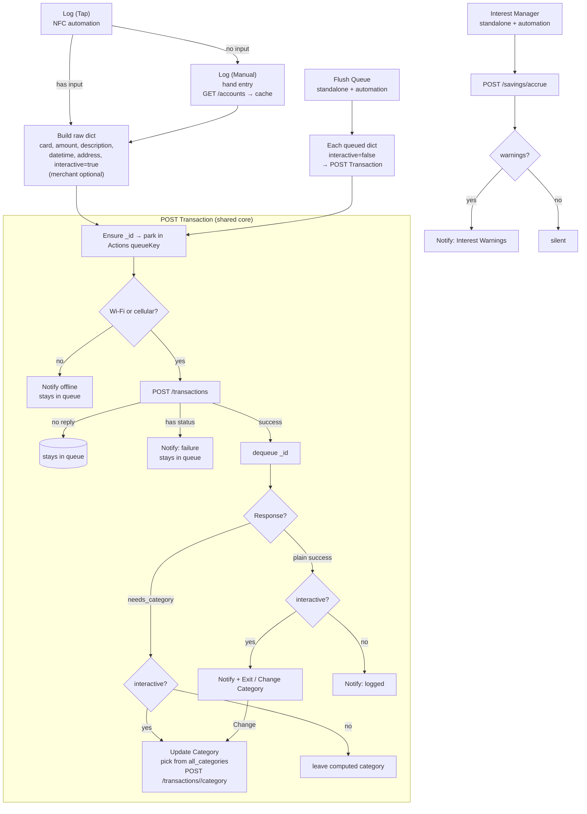

# Apple Shortcut

[Docs](../index.md) › Guides › Apple Shortcut

## Overview

The phone client is a suite of small Shortcuts that POST to The Bridge. This page is the **client contract**: auth header, error shape, `_id` / `interactive` echo, and how the suite is wired.

## How it works

### Auth and errors

- Send `X-API-Key: <API_SECRET>` on every protected call.
- Errors use `{status, message}` — the shortcut treats a present `status` key as failure.
- Check response keys in order: `status` (error) → `needs_category` (prompt) → otherwise success.

### Passthrough echo

| Key | Echoed on | Also stored |
| --- | --------- | ----------- |
| `_id` | Success and error | Notion `_id` rich-text on successful create |
| `interactive` | Success only | — |

Passthrough applies to both transaction endpoints. Use `_id` to correlate Shortcut ↔ logs ↔ Notion. For category updates, the URL `<page_id>` must be the Notion `page_id`, not this `_id`.

### Suite layout

Needs the **Actions** app (global text variables for the offline queue and accounts cache; rich notifications threaded by `_id`). Shared variables: `baseURL`, `apiKey`.

| Shortcut | Role | Link |
| -------- | ---- | ---- |
| `Log (Tap)` | NFC entry: builds raw dict from tap input, asks for description, runs `POST Transaction` | [iCloud](https://www.icloud.com/shortcuts/d8322e959c1149c0ae022b70304d6f58) |
| `Log (Manual)` | Hand entry: refreshes accounts from `GET /accounts`, prompts for fields, runs `POST Transaction` | [iCloud](https://www.icloud.com/shortcuts/509ef97c9eef4eff8cf7bc2f9028765d) |
| `POST Transaction` | Shared core: `_id`, queue, POST `/transactions`, branch on reply | [iCloud](https://www.icloud.com/shortcuts/4ab1b4424d674733aef6839f4d2d02d7) |
| `Update Category` | Picker from `all_categories` → `POST /transactions/<page_id>/category` | [iCloud](https://www.icloud.com/shortcuts/c5b8e61bbfc942eface2e6080963e277) |
| `Flush Queue` | Replays queued dicts with `interactive` off | [iCloud](https://www.icloud.com/shortcuts/f131751c47864658ad245013ef5e4bf8) |
| `Interest Manager` | Daily `POST /savings/accrue`; notifies only when `warnings` is non-empty | [iCloud](https://www.icloud.com/shortcuts/e1af18dfc0f74c5aa5e82240985b8f75) |

Both entry points seed `address`, `datetime`, and `interactive: true`. `description` is the row title; `merchant` is optional and only feeds category memory.

### Offline queue

`POST Transaction` parks the dict in Actions (`queueKey`, keyed by `_id`) *before* the network call. Offline or aborted sends leave the entry queued. `Flush Queue` replays with `interactive: false`; successes dequeue inside `POST Transaction`.

### Flow

## Setup / enabling

1. Install the Actions app and import the shortcuts above.
2. Set `baseURL` to your bridge host and `apiKey` to `API_SECRET`.
3. Optionally schedule `Flush Queue` (Wi-Fi connects / daily) and `Interest Manager` (daily).

Config for the server side: [Configuration](../reference/configuration.md).

## Endpoints

- [`POST /transactions`](../reference/api.md#post-transactions)
- [`POST /transactions/<page_id>/category`](../reference/api.md#post-transactionspage_idcategory)
- [`GET /accounts`](../reference/api.md#get-accounts)
- [`POST /savings/accrue`](../reference/api.md#post-savingsaccrue)

## Warnings & gotchas

- Never put the client `_id` in the category URL path — use Notion `page_id`.
- Non-interactive runs (`Flush Queue`) skip the category picker; ambiguous rows keep their computed value.
- Notification titles look like `Transaction <_id> (PLEASE READ THE ACTION DESCRIPTION)`; the real body is in the action description.

## Related

- [Transactions](./transactions.md)
- [Categories](./categories.md)
- [Accounts](./accounts.md)
- [Savings interest](./savings-interest.md)
- [API reference](../reference/api.md)
