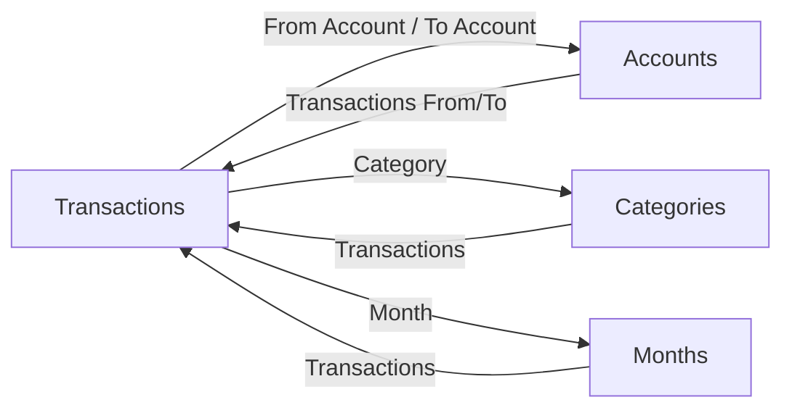

# Notion schema

[Docs](../index.md) › [Guides](./) › Notion schema

## Overview

The Bridge writes into four related Notion databases: **Transactions**, **Accounts**, **Categories**, and **Months**. Duplicate the published [Money Tracker Template](https://bowlyntemplates.notion.site/Money-Tracker-Template-d912544cf35f8352978681045f4d3e67), share those data sources with your integration, and point the `*_DS_ID` env vars at them.

This page is the schema source of truth: how the databases link, which properties the bridge needs, and which exist for the dashboard. Feature guides cover behaviour; they do not re-list the full property map.

Property roles:

| Tag                 | Meaning                                                                            |
| ------------------- | ---------------------------------------------------------------------------------- |
| **bridge-required** | The bridge reads or writes this; missing it breaks or degrades a feature           |
| **bridge-optional** | Written when present; safe to omit                                                 |
| **dashboard**       | Powers balances, budgets, and views in the template; not required for the HTTP API |

## How it works

### Relations

Transactions is the hub. Account, category, and month pages receive reverse relations (and rollups/formulas on top) so the dashboard can show balances and spend without the bridge computing them.

### Expected use

- **Daily logging** — Apple Shortcut (or any client) posts to the bridge; a Transaction row is created; relations resolve; dashboard rollups update.
- **Card linking** — put Apple's card name in `Apple Card`, or pick by account **Name** (codename). Tick `Archived` to hide an account from resolution and listings. See [Accounts](./accounts.md).
- **Categories** — Notion holds the name list; merchant memory lives on the bridge disk. Include an `Interest` category if you use savings payouts with the default category name. See [Categories](./categories.md).
- **Months** — pre-create month rows titled like `Aug 2026` (`Mon YYYY`, English abbrev) so the Month relation can match. The bridge never creates month pages.
- **Savings** — on an account: tick `Earns Interest`, set `AER %` and `Interest Payment Day`, ensure the account still resolves as a card, and schedule daily `POST /savings/accrue`. See [Savings interest](./savings-interest.md).

### Transactions

| Property                                                                                       | Type                    | Role                                                                                    |
| ---------------------------------------------------------------------------------------------- | ----------------------- | --------------------------------------------------------------------------------------- |
| `Name`                                                                                         | title                   | **bridge-required** — description / merchant                                            |
| `Amount`                                                                                       | number                  | **bridge-required** — signed by type (`expense`/`transfer` negative, `income` positive) |
| `Date`                                                                                         | date                    | **bridge-required** — from request `datetime` (or now)                                  |
| `From Account`                                                                                 | relation → Accounts     | **bridge-required** for expense and transfer                                            |
| `To Account`                                                                                   | relation → Accounts     | **bridge-required** for income and transfer                                             |
| `Category`                                                                                     | relation → Categories   | **bridge-required** lookup target (best-effort; blank + `warnings` if unmatched)        |
| `Month`                                                                                        | relation → Months       | **bridge-required** lookup target; name must match `%b %Y`                              |
| `_id`                                                                                          | text                    | **bridge-optional** — client correlation id                                             |
| `rawPayload`                                                                                   | text                    | **bridge-optional** — JSON of the request (truncated)                                   |
| `Notes`                                                                                        | text                    | **dashboard**                                                                           |
| `Place`                                                                                        | place                   | **dashboard**                                                                           |
| `Parent item` / `Sub-item`                                                                     | relation → Transactions | **dashboard** — nesting                                                                 |
| `Current Month Check`, `Current Month Cost`, `Chart Value`, `Flow (Sender)`, `Flow (Receiver)` | formula                 | **dashboard** — spend filters and chart/flow helpers                                    |

Sign and account roles match the forms in the template:

| Type     | Amount   | Accounts filled               |
| -------- | -------- | ----------------------------- |
| expense  | negative | `From Account`                |
| income   | positive | `To Account`                  |
| transfer | negative | `From Account` + `To Account` |

### Accounts

| Property                                    | Type                    | Role                                                                                                |
| ------------------------------------------- | ----------------------- | --------------------------------------------------------------------------------------------------- |
| `Name`                                      | title                   | **bridge-required** — codename used in pickers and resolution                                       |
| `Apple Card`                                | text                    | **bridge-required** for tap logging — exact Apple card label (leave blank for manual-only accounts) |
| `Archived`                                  | checkbox                | **bridge-required** — archived rows are skipped                                                     |
| `Earns Interest`                            | checkbox                | **bridge-required** for savings enrolment                                                           |
| `AER %`                                     | number                  | **bridge-required** when enrolled — AER as a percent (e.g. `3.6`)                                   |
| `Interest Payment Day`                      | number                  | **bridge-required** when enrolled — day of month                                                    |
| `Current Balance`                           | formula (number)        | **bridge-required** for accrual — interest base (also **dashboard**)                                |
| `Accrued Interest`                          | number                  | **bridge-required** — running accrual the bridge writes                                             |
| `Last Accrued`                              | date                    | **bridge-required** — daily idempotency                                                             |
| `Last Interest Paid`                        | date                    | **bridge-required** — monthly payout guard                                                          |
| `Transactions (From)` / `Transactions (To)` | relation → Transactions | **dashboard** — reverse of From/To Account                                                          |
| `Sum: Incoming` / `Sum: Outgoing`           | rollup                  | **dashboard** — feed `Current Balance`                                                              |

Savings property *names* are env-tunable — [Configuration](../reference/configuration.md). Defaults match the names above.

### Categories

| Property               | Type                    | Role                                                                 |
| ---------------------- | ----------------------- | -------------------------------------------------------------------- |
| `Name`                 | title                   | **bridge-required** — exact match for `category` and merchant memory |
| `Transactions`         | relation → Transactions | **dashboard** — reverse of Category                                  |
| `Budget`               | number                  | **dashboard**                                                        |
| `Current Month Spend`  | rollup                  | **dashboard**                                                        |
| `Remaining`, `% Spent` | formula                 | **dashboard**                                                        |

Seed at least the categories you care about, including `Interest` if you keep the default savings payout category.

### Months

| Property       | Type                    | Role                                                                   |
| -------------- | ----------------------- | ---------------------------------------------------------------------- |
| `Name`         | title                   | **bridge-required** — must match `strftime("%b %Y")` (e.g. `Jul 2026`) |
| `Transactions` | relation → Transactions | **dashboard** — reverse of Month                                       |
| `Date Range`   | date (range)            | **dashboard** — calendar span of the month                             |
| `Status`       | status                  | **dashboard** — e.g. Future / Active / Past                            |
| `Net Result`   | formula                 | **dashboard**                                                          |

Pre-seed months ahead of time. A missing month name leaves the relation blank and appears under `warnings` on a successful create — it does not block the write.

## Setup / enabling

### From the template

1. Duplicate [Money Tracker Template](https://bowlyntemplates.notion.site/Money-Tracker-Template-d912544cf35f8352978681045f4d3e67).
2. Create a Notion internal integration and share **Transactions**, **Accounts**, **Categories**, and **Months** with it.
3. Copy each data source ID into `.env` — [Configuration](../reference/configuration.md).
4. Add account rows (codenames, optional `Apple Card`), category names, and enough Months for the current year.
5. For interest-bearing accounts: tick `Earns Interest`, set `AER %` and `Interest Payment Day`.

### Recreate or verify by hand

1. Create the four databases and wire the relations in the diagram above (Transactions owns From/To Account, Category, Month; reverse relations on the other three).
2. Add every **bridge-required** and **bridge-optional** column from the tables above.
3. Add **dashboard** rollups/formulas if you want balances and budgets (intent: Incoming − Outgoing style balance on Accounts; current-month spend vs Budget on Categories). Exact formula text is not required for the bridge.
4. Share with the integration and set the four `*_DS_ID` values plus `NOTION_TOKEN`.

## Endpoints

Schema is Notion-side. The bridge surfaces that data through:

- `[GET /accounts](../reference/api.md#get-accounts)` — account codenames
- `[POST /transactions](../reference/api.md#post-transactions)` — create a transaction row
- `[POST /transactions/<page_id>/category](../reference/api.md#post-transactionspage_idcategory)` — set Category
- `[POST /savings/accrue](../reference/api.md#post-savingsaccrue)` — daily accrual / monthly payout

## Warnings & gotchas

- Month titles must match the bridge locale format (`Aug 2026`, not `August 2026` or `2026-08`).
- Unmatched Category or Month names succeed with `warnings`; unknown `card` / `to_account` hard-fails.
- Duplicate labels across codenames and `Apple Card` values make the accounts map refuse to load.
- Dashboard formulas and ATM layout are template UX — changing them does not break the API as long as bridge property names stay intact (or env overrides match).

## Related

- [Getting started](./getting-started.md)
- [Transactions](./transactions.md)
- [Accounts](./accounts.md)
- [Categories](./categories.md)
- [Savings interest](./savings-interest.md)
- [Configuration](../reference/configuration.md)
- [API reference](../reference/api.md)

